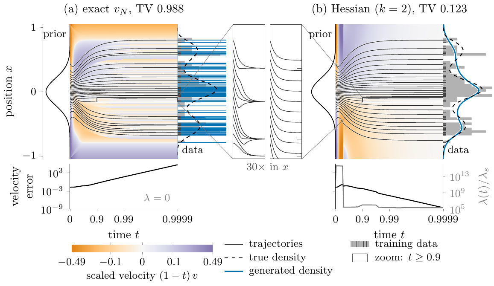

# Explicit Regularization for Flow Matching

Code of the paper "[Explicit Regularization for Flow Matching](https://arxiv.org/abs/2611.19587)" by Lars Ruthotto and Eran
Treister. It computes every table, figure and number of the paper, including its appendices.

*Figure 1 of the paper: flows of (a) the empirical velocity and (b) the velocity with the
Hessian regularizer and hold-out lambda(t), trimodal target, N = 100 training points. The
trajectories of the empirical flow end on the training points; those of the regularized flow
do not.*

Generative models based on flow matching learn a velocity field whose flow transports a known
distribution to the data distribution. The empirical learning problem is ill posed near the
data: its minimizer transports the samples onto the training points, and small perturbations
of the data change the velocity strongly near the end of the flow. The paper shows that a
penalty on the magnitude of the velocity either memorizes or keeps the velocity uniformly
small, whereas a penalty on the derivatives of order k makes the D-dimensional problem well
posed uniformly in time if 2k > D. The experiments in one and two dimensions fit the velocity at
fixed times by penalized least squares in a cubic B-spline basis, solve the normal equations by
sparse Cholesky, select lambda(t) by hold-out, and sample with RK4. Refining the discretization
changes the error of the regularized flows only marginally, whereas without the regularizer the
error tends to that of memorization; the regularized flows have errors comparable to or lower
than kernel density estimates with data-driven bandwidths.

## Install

    uv sync --frozen --extra cholmod

Python >= 3.12 (CI tests 3.12 and 3.13); `uv.lock` pins every version. The `cholmod` extra
installs cvxopt (CHOLMOD), the sparse Cholesky solver of the production runs. The code runs on
CPUs only. The report stage and the smoke runs need a laptop; the production runs used
machines with 40 and 96 cores and 14 to 28 worker processes per run. The Makefile and the scripts
set the BLAS threads to 1; `NWORKERS` sets the number of worker processes.

## Reproduce the paper

The report stage writes all tables and figures from the published results in seconds. The
compute stage took about 6800 core-hours on Intel Xeon cores (126 invocations, one BLAS
thread per worker); spread over 70 cores this is about 4 days. The smoke run of
every script with reduced sizes takes a few hours.

`docs/REPRODUCE.md` maps every table, figure and number of the paper to the report function,
the results and the compute script behind it, and gives the commands and the cost of each run.
In short:

    make fetch-results                                           # the results from Zenodo, checksum-verified
    make release-report OUT=<dir>                                # tables and figures, seconds
    make smoke                                                   # every compute script, reduced
    make compute-<name>                                          # one full compute run

The results archive (161 MB, [doi:10.5281/zenodo.24310380](https://doi.org/10.5281/zenodo.24310380)) holds the 123 result files the report reads and the manifests and
logs of the 126 runs; `experiments/report/results_archive.txt` records its URL and sha256. The
results were computed with earlier versions of this code. The commit hashes in the archive's
`SOURCES.txt`, in the manifests and in `docs/REPRODUCE.md` identify commits of the authors'
development repository, whose history this repository does not contain. The code of this
release regenerates every table and figure file of the paper from the archived results byte
for byte.

## Layout

| path | contents |
|---|---|
| `src/smoothfm/` | the package: latent, targets, splines, regularizers, normal equations, solvers, parameter selection, sampler, metrics, baselines, run logs; constants in `config.py` |
| `experiments/compute/` | stage 1, one script per experiment (hours) |
| `experiments/report/` | stage 2, tables and figures from one results directory (seconds) |
| `experiments/paper/` | the generated tables and figures the paper inputs |
| `experiments/runs.txt` | every compute run with the results it reads |
| `docs/` | `REPRODUCE.md`, the map from the paper to the code |
| `tests/` | `make test` (unit), `make test-all` (adds smoke runs of every script and the report regression) |

## Citation

    @misc{ruthotto2026explicit,
      title         = {Explicit Regularization for Flow Matching},
      author        = {Ruthotto, Lars and Treister, Eran},
      year          = {2026},
      eprint        = {2611.19587},
      archivePrefix = {arXiv},
      primaryClass  = {stat.ML},
      url           = {https://arxiv.org/abs/2611.19587}
    }

The results archive:

    @dataset{ruthotto2026results,
      title     = {Results of ``Explicit Regularization for Flow Matching''},
      author    = {Ruthotto, Lars and Treister, Eran},
      year      = {2026},
      publisher = {Zenodo},
      version   = {arxiv-v1},
      doi       = {10.5281/zenodo.24310380}
    }

## Acknowledgements

This work was supported in part by the US-Israeli NSF-BSF award 2411264. Lars Ruthotto's work
is supported in part by NSF award DMS-2038118.

Claude Opus 5.5 (Anthropic), used through Claude Code, wrote the code and ran and managed the
computational experiments. For the paper, the authors also used it as a writing assistant, as a
proof assistant, to review intermediate drafts, to search the literature and to check the
bibliographic entries against publisher records. The authors have reviewed all code and the
entire paper and take responsibility for their content.

## License

The code is under the MIT License, see `LICENSE`. The results archive is under CC BY 4.0
(its `README.md`).
